<picture>
  <source media="(prefers-color-scheme: dark)" srcset="./assets/hero-dark.svg">
  
</picture>

Software engineer at Lowe's on the Wallet platform: payments, gift and credit cards, and checkout, on Java services that consume over a million Kafka events a day. I also built the team's AI layer, an MCP-based agent platform. On my own time I train small language models in PyTorch and publish the weights, the evals and the null results. That side work is my own and not my employer's.

<picture>
  <source media="(prefers-color-scheme: dark)" srcset="./assets/journey-dayjob-dark.gif">
  
</picture>

## Models

| Model | What it is | Result |
|---|---|---|
| [NPC Fast 1.7B](https://huggingface.co/ramankrishna10/npc-fast-1.7b) | Request router on SmolLM2-1.7B, context extended to 16K | 98.3% routing accuracy out of distribution ([paper](https://doi.org/10.5281/zenodo.19771040)) |
| [Fin-PRM 7B](https://huggingface.co/ramankrishna10/npc-fin-prm-7b) | Process reward model on Qwen2.5-7B, scoring four dimensions | Spearman 0.92, F1 0.84 ([paper](https://doi.org/10.5281/zenodo.19800784)) |
| [NPC Agentic 7B v3](https://huggingface.co/ramankrishna10/npc-agentic-7b-v3) | Tool-use model on Qwen2.5-7B with its own [benchmark harness](https://github.com/ramankrishna/bench-npc-agentic-v3) | BFCL v4, IFEval and AgentBench under one serving setup ([paper](https://doi.org/10.5281/zenodo.19954103)) |
| [NPC Fin 32B](https://huggingface.co/ramankrishna10/npc-fin-32b-sft) | Finance model on Qwen2.5-32B, trained on 12 H100s | CryptoQA 93.6% ([paper](https://doi.org/10.5281/zenodo.19802598)) |

<picture>
  <source media="(prefers-color-scheme: dark)" srcset="./assets/journey-models-dark.gif">
  
</picture>

One cube is a billion parameters. NPC Fast reads each request and answers the easy ones itself. Hard ones are escalated to NPC Fin, and Fin-PRM scores each step of the reasoning.

## Tools

<picture>
  <source media="(prefers-color-scheme: dark)" srcset="./assets/journey-tools-dark.gif">
  
</picture>

| Project | What it does |
|---|---|
| [attest-ledger](https://github.com/ramankrishna/attest-ledger) | Claude Code mod that checks "all tests pass" against what actually ran |
| [polyrt](https://github.com/ramankrishna/polyRT) | One call shape for Claude, GPT and local MLX models |
| [npc-mom-router](https://github.com/ramankrishna/npc-mom-router) | Sends easy requests to small models and hard ones to specialists |
| [reasoning-bank](https://github.com/ramankrishna/reasoning-bank) | ReasoningBank for agents, with the experiments where it gave no lift |
| [bottensor-fleet](https://github.com/ramankrishna/bottensor-fleet) | Graph-native multi-agent fleet, local first |
| [forge](https://github.com/ramankrishna/forge), [engram](https://github.com/ramankrishna/engram), [cogito](https://github.com/ramankrishna/cogito) | Agent framework, graph memory and reasoning strategies in TypeScript |

Models are on [Hugging Face](https://huggingface.co/ramankrishna10), papers are under ORCID [0009-0000-1298-0681](https://orcid.org/0009-0000-1298-0681), and I'm on [LinkedIn](https://www.linkedin.com/in/ramakrishna-bachu10/).
